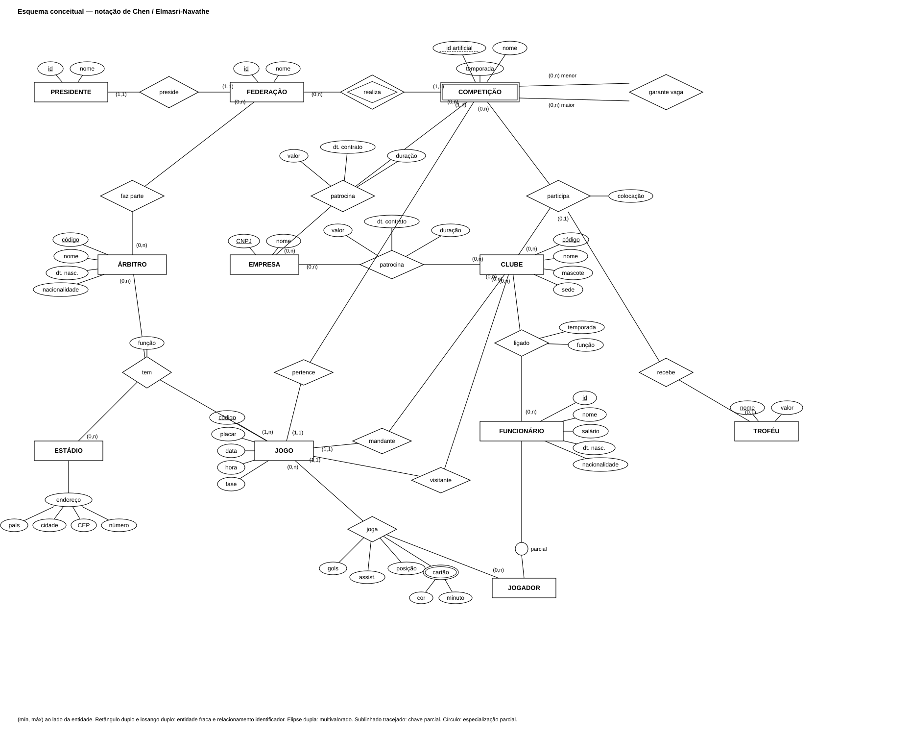
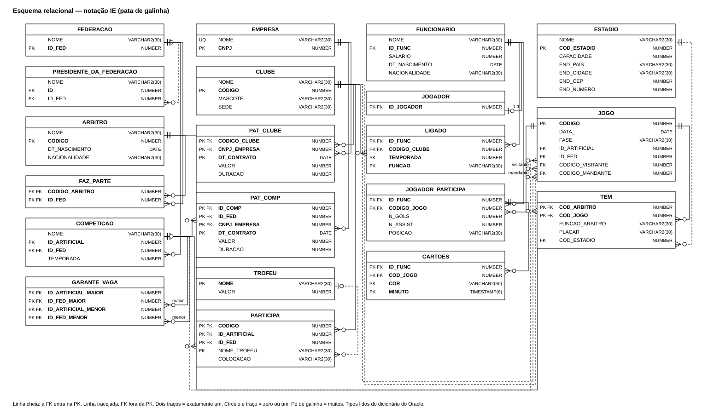
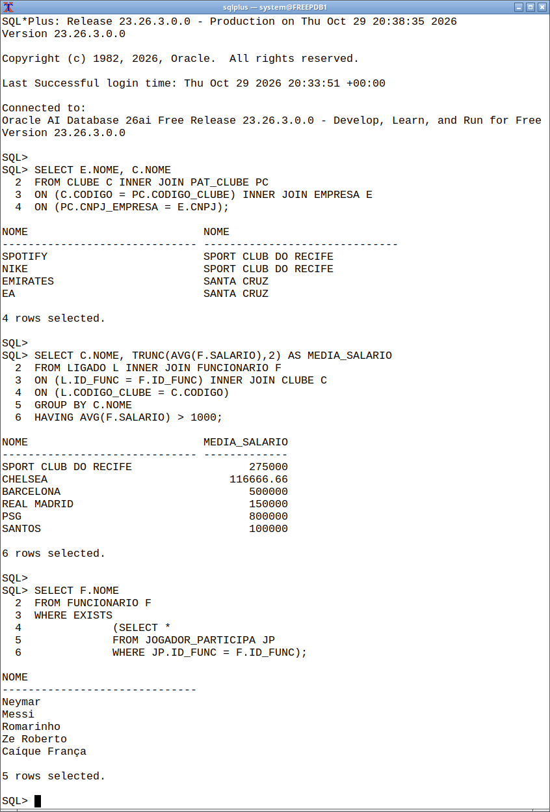
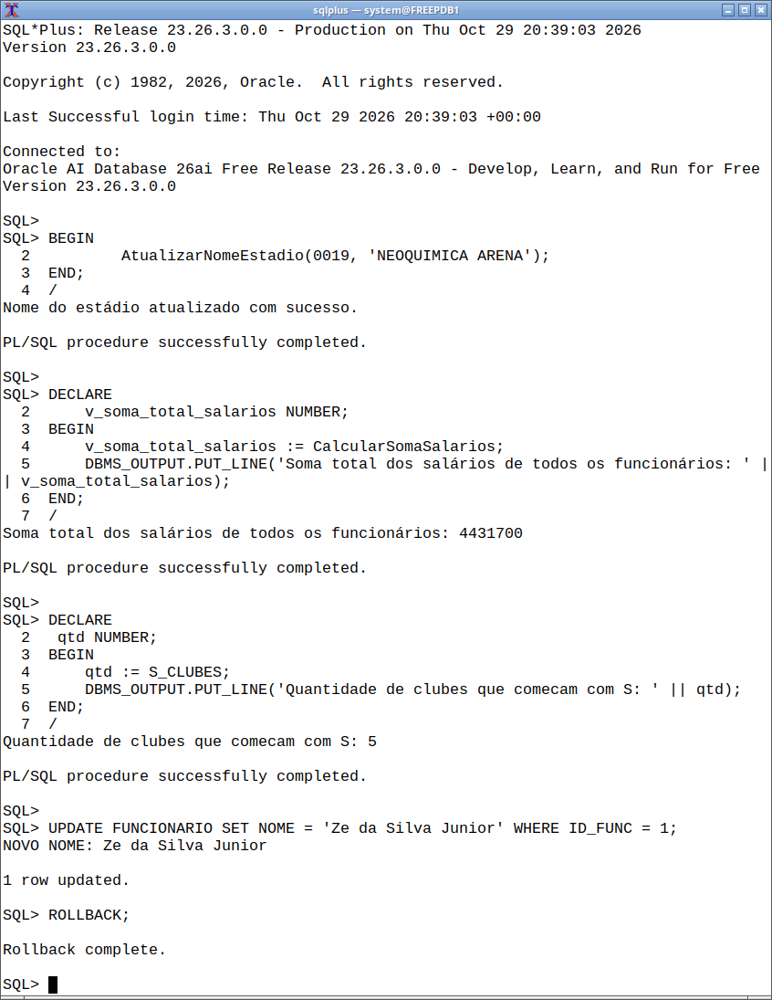

# Mini-Mundo Futebol

[](https://www.cin.ufpe.br/)
[](SQL/)
[](docs/resultados-plsql.png)

Banco de dados de futebol de clubes: federações, competições, partidas, elencos e patrocínios. O repositório guarda o mini-mundo, o projeto lógico e a implementação em Oracle SQL, com consultas, gatilhos, procedure e funções PL/SQL.

Projeto da disciplina **Gerenciamento de Dados e Informação**, do Centro de Informática da UFPE. O repositório é de [Ian Medeiros Melo](https://github.com/iianmelo) (`imm2`). A capa da apresentação lista a equipe inteira; os papéis de cada pessoa não estão descritos nos arquivos.

## Sumário

- [Contexto](#contexto)
- [Mini-mundo](#mini-mundo)
- [Modelagem](#modelagem)
- [Esquema](#esquema)
- [SQL e PL/SQL](#sql-e-plsql)
- [Resultados](#resultados)
- [Como executar](#como-executar)
- [Estrutura do repositório](#estrutura-do-repositório)
- [O que o projeto exercita](#o-que-o-projeto-exercita)
- [Equipe](#equipe)
- [Links](#links)

## Contexto

O texto de abertura do repositório, desde fevereiro de 2024, apresenta o trabalho como projeto da disciplina de Gerenciamento de Dados e Informação do CIn-UFPE. O objetivo escrito é armazenar dados sobre futebol em geral.

O código do período letivo não aparece nos arquivos. As datas que o Git registra são estas:

| Marco | Data |
| --- | --- |
| Commit inicial (`Initial commit`, Ian Melo) | 12 nov 2023 |
| Mini-mundo no README, projeto lógico, SQL e apresentação | 27 fev 2024 a 21 mar 2024 |

Não há nota, carga horária nem divisão de tarefas no repositório.

## Mini-mundo

O domínio está escrito no README original e repetido na apresentação `Apresentação/MINIMUNDO FUTEBOL GDI.pptx`. Em uma frase: federações organizam competições; clubes disputam essas competições e jogam entre si; funcionários, entre eles jogadores, se ligam a clubes; empresas patrocinam clubes e competições; árbitros apitam jogos em estádios.

O texto fixa algumas regras que o desenho abaixo usa como cardinalidade `(mín, máx)` — quantos vínculos daquele relacionamento uma ocorrência entra:

- Um presidente preside exatamente uma federação, e uma federação tem exatamente um presidente.
- Uma competição é organizada por uma federação. Uma federação realiza várias competições.
- Uma competição menor pode garantir vaga em várias competições maiores, e o caminho inverso também existe.
- Um funcionário pode estar ligado a vários clubes, em várias temporadas e funções. A temporada e a função identificam o vínculo junto com a pessoa e o clube.
- Um funcionário pode ser um jogador. Jogador não tem atributos próprios no texto.
- Um jogador entra em vários jogos. Em cada jogo registra gols, assistências e posição, e pode receber vários cartões, cada um com cor e minuto.
- Todo jogo tem um clube mandante e um clube visitante, e vale para uma única competição. Uma competição tem vários jogos.
- Na participação de um clube em uma competição há uma colocação e, no máximo, um troféu. Um troféu é dado a uma única participação.
- Um patrocínio de clube ou de competição tem valor, data de contrato e duração. O mesmo par pode ter contratos em datas diferentes.
- Um árbitro pode fazer parte de várias federações. Em um jogo, num estádio, há vários árbitros, cada um com uma função.

Estádio tem endereço composto: país, cidade, CEP e número. O texto também atribui ao jogo placar, data, hora e fase.

## Modelagem

O conceitual abaixo lê o mini-mundo. A notação é a de Chen / Elmasri-Navathe: retângulo para entidade, losango para relacionamento, elipse para atributo, cardinalidade `(mín, máx)` ao lado da entidade.



O projeto lógico escrito está em [`Mapeamento/PROJETO LÓGICO GDI (1).pdf`](Mapeamento/PROJETO%20L%C3%93GICO%20GDI%20(1).pdf) (exportado do Google Docs, duas páginas). O DDL de [`SQL/create.sql`](SQL/create.sql) segue esse texto na maior parte e diverge em pontos localizados:

| No texto ou no PDF lógico | No `CREATE TABLE` |
| --- | --- |
| `JOGO` tem placar, data, hora e fase | `JOGO` tem `DATA_` e `FASE`. Não há coluna de hora. O placar ficou em `TEM` |
| `TEM` lista `FUNCAO_ARBITRO` duas vezes e também tem placar | `TEM` tem a função uma vez, mais `PLACAR` e `COD_ESTADIO NOT NULL` |
| `CARTÕES` referencia `PARTICIPA` | `CARTOES` referencia `JOGADOR_PARTICIPA` |
| Presidente 1:1 com a federação, com `ID_FED` obrigatório no PDF (`[ID_FED]!`) | `ID_FED` é só chave estrangeira: aceita nulo e não é `UNIQUE` |
| `EMPRESA` identificada pelo CNPJ | o CNPJ é a chave, e `NOME` ganhou `UNIQUE` num commit posterior |
| Jogador é especialização de funcionário | a tabela `JOGADOR` existe, mas `JOGADOR_PARTICIPA` aponta para `FUNCIONARIO` |

O endereço composto virou quatro colunas (`END_PAIS`, `END_CIDADE`, `END_CEP`, `END_NUMERO`). Relacionamentos N:N com atributos viraram tabelas: `LIGADO`, `PAT_CLUBE`, `PAT_COMP`, `PARTICIPA`, `FAZ_PARTE`, `GARANTE_VAGA`. O cartão multivalorado virou `CARTOES`, com chave `(ID_FUNC, COD_JOGO, COR, MINUTO)`.

Não há modelo objeto-relacional: o script não cria tipo, `REF`, `VARRAY` nem tabela aninhada.

## Esquema

Vinte tabelas, na notação de pata de galinha. Os tipos são os do dicionário do Oracle (`VARCHAR2`, `NUMBER`, `DATE`, `TIMESTAMP`), não o sinônimo escrito no script. Linha cheia: a chave estrangeira faz parte da primária. Linha tracejada: não faz.



Há também um [`docs/esquema-logico.mmd`](docs/esquema-logico.mmd) em Mermaid, gerado a partir das mesmas colunas. A cardinalidade de lá segue as chaves estrangeiras do DDL, não o `(mín, máx)` do texto.

Contagem depois de [`SQL/povoamento.sql`](SQL/povoamento.sql), na execução descrita em [Resultados](#resultados):

| Tabela | Linhas | Papel |
| --- | ---: | --- |
| `FEDERACAO` | 11 | CBF, federações estaduais e continentais, FIFA |
| `PRESIDENTE_DA_FEDERACAO` | 11 | um nome por federação na carga |
| `COMPETICAO` | 20 | chave `(ID_ARTIFICIAL, ID_FED)` e temporada |
| `GARANTE_VAGA` | 0 | auto-relacionamento de competição |
| `ARBITRO` | 16 | |
| `FAZ_PARTE` | 0 | árbitro ↔ federação |
| `ESTADIO` | 29 | |
| `CLUBE` | 35 | |
| `EMPRESA` | 36 | `NOME` único |
| `PAT_CLUBE` | 4 | |
| `PAT_COMP` | 1 | só a Emirates, na carga |
| `TROFEU` | 3 | |
| `PARTICIPA` | 8 | clube numa competição, com colocação e troféu opcional |
| `FUNCIONARIO` | 16 | |
| `JOGADOR` | 0 | especialização; ninguém foi inserido |
| `LIGADO` | 13 | funcionário, clube, temporada e função |
| `JOGO` | 8 | oito `INSERT`s ativos; outros ficaram comentados |
| `TEM` | 5 | árbitro, jogo, função, placar e estádio |
| `JOGADOR_PARTICIPA` | 5 | gols, assistências e posição |
| `CARTOES` | 0 | |

Os `INSERT`s de jogo comentados ainda usam o formato antigo, com o placar na segunda posição. Não batem com o `CREATE TABLE` atual.

Literais numéricos com zeros à esquerda, como `0001` e `0420`, são gravados sem esses zeros. O clube `0001` aparece como `1` na consulta escalar.

## SQL e PL/SQL

Tudo está em [`SQL/Consultas.sql`](SQL/Consultas.sql). As consultas pedidas pela disciplina estão lá, com o comentário do tipo ao lado.

**Junção externa.** Empresas que não patrocinam competição:

```sql
SELECT E.NOME
FROM EMPRESA E LEFT OUTER JOIN PAT_COMP PC
ON (E.CNPJ = PC.CNPJ_EMPRESA)
WHERE PC.CNPJ_EMPRESA IS NULL;
```

**Subconsultas.** Há três formas: tabela (`CNPJ IN (SELECT ...)` sobre `PAT_CLUBE`), escalar (o CNPJ da empresa de nome `EMIRATES`) e linha (mesmo ano de nascimento e mesma nacionalidade do funcionário `001`, com `TO_CHAR` e comparação de tupla).

**Semi-junção e anti-junção.** `EXISTS` em `JOGADOR_PARTICIPA` para quem entrou em campo; `NOT EXISTS` para federação sem presidente.

**Agregação.** Média de salário por clube, só quando passa de 1000:

```sql
SELECT C.NOME, TRUNC(AVG(F.SALARIO),2) AS MEDIA_SALARIO
FROM LIGADO L INNER JOIN FUNCIONARIO F
ON (L.ID_FUNC = F.ID_FUNC) INNER JOIN CLUBE C
ON (L.CODIGO_CLUBE = C.CODIGO)
GROUP BY C.NOME
HAVING AVG(F.SALARIO) > 1000;
```

**Conjunto.** `UNION` entre empresas que patrocinam clube e empresas que patrocinam competição.

**Gatilhos.** `MudancaDeNome` e `MudancaDePresidente` são `BEFORE UPDATE`, por linha, e imprimem o valor novo quando ele muda:

```sql
CREATE OR REPLACE TRIGGER MudancaDeNome
BEFORE UPDATE OF NOME ON FUNCIONARIO
FOR EACH ROW
BEGIN
    IF(:NEW.NOME<>:OLD.NOME)THEN
        DBMS_OUTPUT.PUT_LINE('NOVO NOME: ' ||:NEW.NOME);
    END IF;
END;
/
```

**Procedure.** `AtualizarNomeEstadio` atualiza `ESTADIO` e usa o cursor implícito `SQL%ROWCOUNT` para dizer se a linha existia. Não há `CURSOR` explícito no script.

**Funções.** `CalcularSomaSalarios` faz `SELECT SUM(SALARIO) INTO` e devolve `NUMBER`. `S_CLUBES` conta clubes cujo nome começa com `S`.

## Resultados

Os scripts foram executados no SQL\*Plus contra **Oracle AI Database 26ai Free Release 23.26.3.0.0**, imagem `gvenzl/oracle-free:23-slim-faststart`. O log da parte de consultas está em [`docs/saida-sqlplus.txt`](docs/saida-sqlplus.txt). `USER_ERRORS` ficou vazio depois da compilação.

As duas figuras abaixo são capturas do SQL\*Plus nessa sessão (`system@FREEPDB1`), com o texto das consultas do repositório.





Leitura curta da mesma execução:

- A junção interna devolve quatro pares: Spotify e Nike com o Sport, Emirates e EA com o Santa Cruz.
- Seis clubes têm média salarial acima de 1000. Chelsea fica em `116666.66` porque `TRUNC` corta a dízima de `(105000 + 150000 + 95000) / 3`.
- Cinco funcionários têm linha em `JOGADOR_PARTICIPA`: Neymar, Messi, Romarinho, Ze Roberto e Caíque França.
- O `UNION` devolve Spotify, Nike, Emirates e EA. Emirates está nos dois lados e sai uma vez.
- Ze da Silva e Francisco da Limpeza nascem em 1999 e são brasileiros.
- Nenhuma federação da carga está sem presidente, então o anti-join volta vazio.
- A função de soma imprime `4431700`. `S_CLUBES` imprime `5`: `SPORT CLUB DO RECIFE`, `SANTA CRUZ`, `SAO PAULO FC`, `SANTOS` e `SEVILLA`.
- O gatilho `MudancaDeNome` imprimiu `NOVO NOME: Ze da Silva Junior` num `UPDATE` de prova; o nome foi desfeito com `ROLLBACK`. A procedure encontrou o estádio `19`.

A ordem das linhas sem `ORDER BY` é a desta execução, não um contrato do `SELECT`.

## Como executar

É preciso Docker e a imagem [`gvenzl/oracle-free`](https://github.com/gvenzl/oci-oracle-free), tag `23-slim-faststart`. A senha abaixo só serve para o container local.

```bash
docker run -d --name gdi-oracle --network host \
  -e ORACLE_PASSWORD=oracle \
  gvenzl/oracle-free:23-slim-faststart

# espere o log dizer DATABASE IS READY TO USE
docker logs -f gdi-oracle

docker cp SQL gdi-oracle:/sql
docker exec -e NLS_LANG=.AL32UTF8 gdi-oracle \
  sqlplus -s system/oracle@//localhost/FREEPDB1 @/sql/executar.sql
```

[`SQL/executar.sql`](SQL/executar.sql) liga `SERVEROUTPUT` e `SQLBLANKLINES` e chama, nesta ordem, `create.sql`, `povoamento.sql` e `Consultas.sql`. O serviço é `FREEPDB1`.

Um ponto e vírgula foi acrescentado depois do `HAVING` em `Consultas.sql`. Sem ele, o SQL\*Plus emendava o `SELECT` seguinte na agregação e o script parava. Foi o único ajuste nos arquivos acadêmicos. Os `INSERT`s comentados de `JOGO` continuam comentados.

Para redesenhar os diagramas: `docs/render_conceitual.py` e `docs/render_logico.py` escrevem o SVG; `rsvg-convert` gera o PNG. `docs/gerar_figuras.py` só regenera o Mermaid. As capturas de resultado não são desenhadas: são a janela do SQL\*Plus ligada ao Oracle Free.

## Estrutura do repositório

```text
.
├── README.md
├── SQL
│   ├── create.sql          # 20 tabelas
│   ├── povoamento.sql      # carga de exemplo
│   ├── Consultas.sql       # consultas, gatilhos, procedure e funções
│   └── executar.sql        # ordem de execução no SQL*Plus
├── Mapeamento
│   └── PROJETO LÓGICO GDI (1).pdf
├── Apresentação
│   └── MINIMUNDO FUTEBOL GDI.pptx
├── docs
│   ├── diagrama-conceitual.svg / .png
│   ├── diagrama-logico.svg / .png
│   ├── esquema-logico.mmd
│   ├── resultados-consultas.png
│   ├── resultados-plsql.png
│   └── saida-sqlplus.txt
└── Mini Mundo Futebol
```

A apresentação tem 29 slides: capa com a equipe, o conceitual, o lógico em recortes e as consultas. As imagens originais do conceitual e do lógico estão dentro do `.pptx`.

## O que o projeto exercita

- Traduzir um texto de mini-mundo para entidades, relacionamentos com atributos, especialização parcial e atributo multivalorado.
- Mapear isso para o relacional: chave composta de competição, tabelas associativas, endereço achatado e cartão como entidade fraca da participação.
- Escrever SQL de junção, subconsulta escalar, de linha e de tabela, semi-junção, anti-junção, `GROUP BY`/`HAVING` e `UNION` em dialeto Oracle (`TO_DATE`, `TO_CHAR`, `TRUNC`, junção externa).
- Compilar PL/SQL: gatilho de linha, procedure com `SQL%ROWCOUNT` e função com `SELECT INTO`.

O que o material não fecha, e o DDL mostra: hora do jogo não foi criada; o placar saiu de `JOGO` e ficou em `TEM`; a especialização `JOGADOR` não restringe quem entra em `JOGADOR_PARTICIPA`; o 1:1 do presidente não virou `UNIQUE`/`NOT NULL`; quatro tabelas (`JOGADOR`, `CARTOES`, `FAZ_PARTE`, `GARANTE_VAGA`) existem e ficaram sem linhas na carga.

## Equipe

Na capa de `Apresentação/MINIMUNDO FUTEBOL GDI.pptx`:

- Guilherme Montenegro (gma4)
- Rafael Alves de Azevedo (raas)
- Ian Medeiros Melo (imm2)
- João Fellows (jvfr)
- Victor Mendonça (vma3)
- Henrique Amorim (hlpaa)

O histórico do Git registra commits de Ian Melo (`imm2@cin.ufpe.br`, `iianmelo`), `hlpaa`, Rafael (`raas@cin.ufpe.br`, `Rafael-Azvedo`), João Fellows, `GuilhermeMontt` e `Mend25`. O repositório não diz quem ficou com cada parte, e não associa o login `Mend25` a um nome da capa.

## Links

- Repositório: [github.com/iianmelo/BancodeDados-GDI](https://github.com/iianmelo/BancodeDados-GDI)
- Projeto lógico: [`Mapeamento/PROJETO LÓGICO GDI (1).pdf`](Mapeamento/PROJETO%20L%C3%93GICO%20GDI%20(1).pdf)
- Apresentação: [`Apresentação/MINIMUNDO FUTEBOL GDI.pptx`](Apresentação/MINIMUNDO%20FUTEBOL%20GDI.pptx)
- Imagem Oracle usada na validação: [`gvenzl/oracle-free:23-slim-faststart`](https://github.com/gvenzl/oci-oracle-free)
